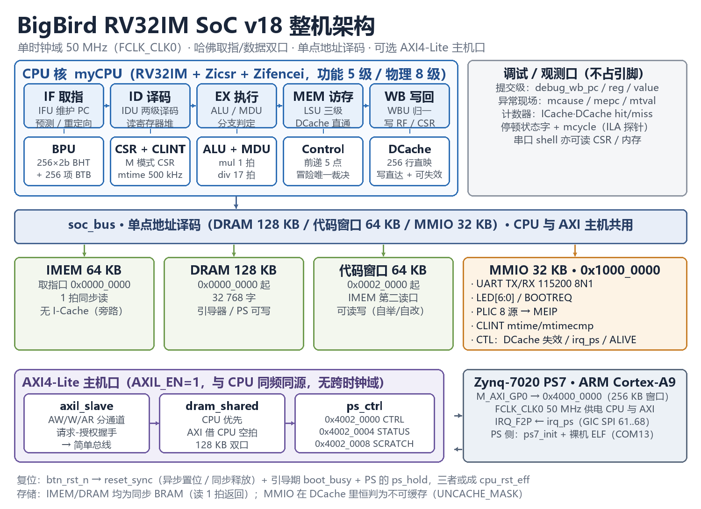
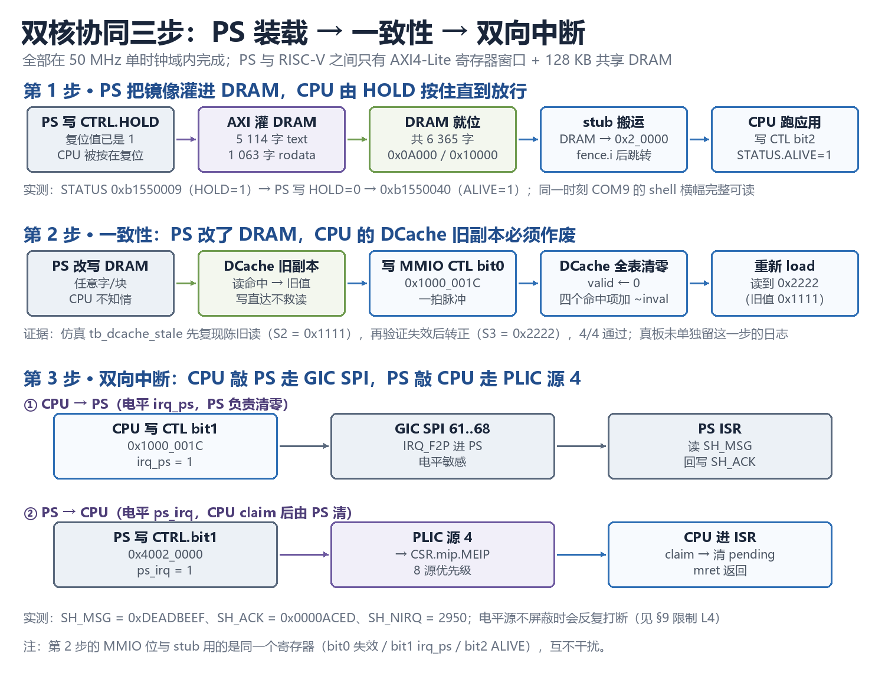
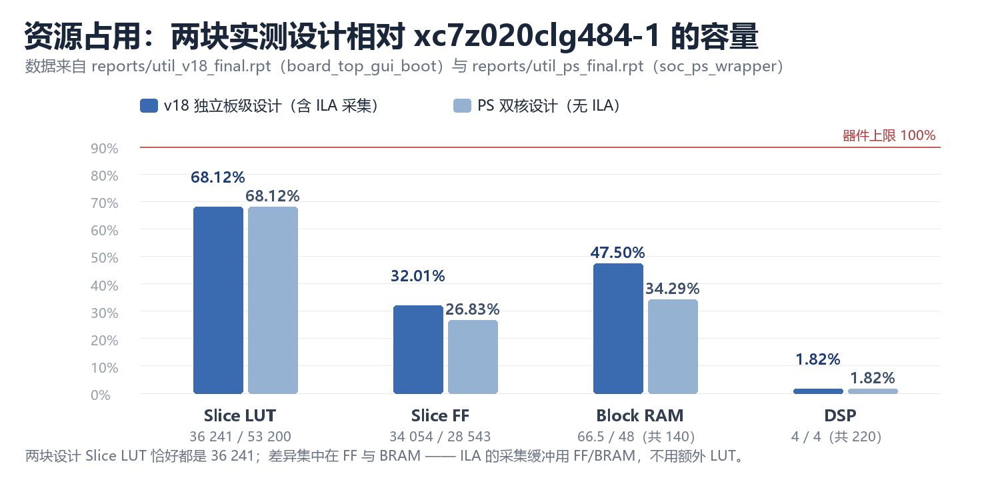
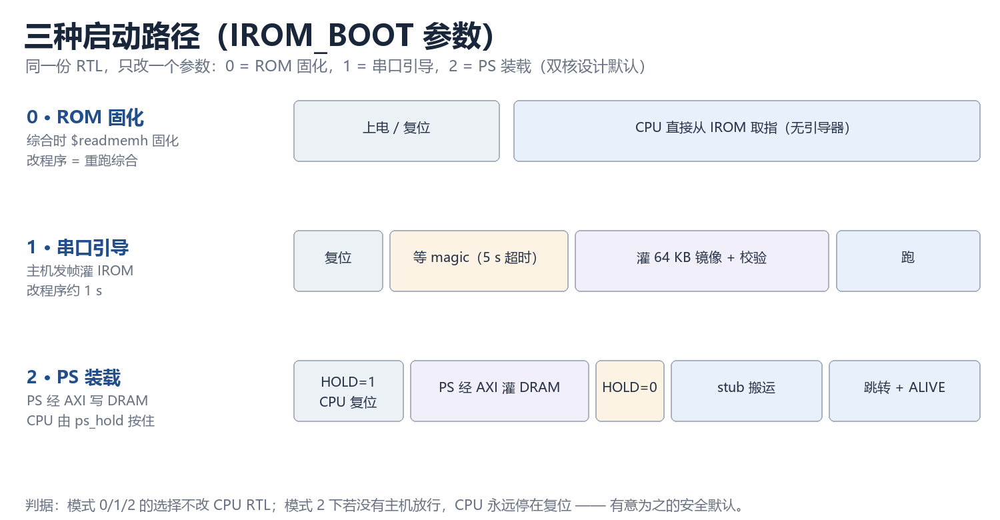

# BigBird RV32IM SoC v18 产品手册
> **状态**：**当前**（2026-11-18）｜对外产品手册（另有 .docx）；数字出处见其附录对照表


> 文档类型：产品手册（Product Manual）｜ 适用版本：v18 ｜ 器件：Xilinx Zynq-7020 `xc7z020clg484-1` ｜ 日期：2026-11-11

## 选型速览

**一句话定位**：一颗能上板、能跑 C、能挂到 Zynq PS 上的 RV32IM 软核 SoC —— 50 MHz 单时钟域、稳态 1 IPC、实测 **2.58 CoreMark/MHz**，自带总线、中断控制器、标准定时器、可交互串口 shell，以及与 ARM 核共享 DRAM、双向中断的双核协同通路。

| 你可能关心的问题 | v18 的答案 |
| --- | --- |
| 指令集 | **RV32IM + Zicsr + Zifencei**：整数基址 + 硬件乘除 + CSR + 指令流屏障；不含 A / F / D / C 扩展 |
| 微架构 | 单发射、顺序执行；对外五级（IF/ID/EX/MEM/WB），内部 **8 个寄存器边界**，稳态 1 IPC |
| 能否上板 | ✅ Vivado 2025.2 综合/实现/比特流全通过，DRC 0 Errors，真板长期跑 shell 与 CoreMark |
| 能跑多快 | 板上 **50 MHz**；后布线 WNS **+0.646 ns**（折算约 51.7 MHz）、PS 设计 **+0.808 ns**（约 52.1 MHz），未做多角点验证 |
| 性能 | **128.82 iter/s @ 50 MHz ⇒ 2.576 CoreMark/MHz**，CRC 与官方值逐位一致 |
| 资源 | Slice LUT **36 241（68.1%）**、FF 34 054、BRAM 66.5 tile、DSP 4（xc7z020） |
| 装得下吗 | ✅ 单板设计占 LUT 68%、BRAM 47.5%；与 PS 共存时 BRAM 降到 34.3%（去掉 ILA） |
| 存储器 | IMEM 64 KB（取指）+ DRAM 128 KB + 代码窗口 64 KB（可读写）+ MMIO 32 KB |
| 缓存 | 数据侧 **DCache 256 行**直接映射、写直达、可整表失效；取指侧 **无 I-Cache**（已旁路，见 §2.3） |
| 中断 | **PLIC-lite 8 源**（电平、claim 清位、固定优先级）+ CLINT 定时器 + 软件中断 |
| 操作系统 | ❌ 仅机器模式，无 MMU / PMP / U 模式；定位是裸机与轻量 RTOS |
| 在线调试 | ⚠️ 无 JTAG DTM；提供 ILA 观测口 + shell 软件断点（单断点，命中即还原） |
| 双核 | ✅ 可作为 AXI4-Lite 从设备挂到 Zynq PS；PS 装载镜像、共享 DRAM、双向中断均已上板 |
| 交付完整性 | RTL + 板级参考设计 + 软件栈 + 53 项回归 + lint/SVA 门禁 + 实测报告 + 本手册 |

---

## 1. 产品定位

### 1.1 它是什么

BigBird v18 是一颗面向 **FPGA 实现**的 32 位 RISC-V 软核，并在 v17 的基础上补齐了"从核到系统"的那一层：**总线、中断控制器、标准定时器、统一地址表、AXI 从口、以及一套能自己在板上跑起来的软件栈**。

设计目标不是"最高性能"，而是**结构清晰、行为可解释、数据可复现**：手册里每一个数字都能在本仓库用免费工具重跑出来，每一次 RTL 改动都有 53 项回归守着。

| 使用者 | 用它做什么 |
| --- | --- |
| 教学与实验平台 | 流水线、前递、Cache、分支预测、总线、中断的**可观测教具**：波形里能逐拍看到冒险与重定向 |
| 科研与验证平台 | 作为 **DUT 基座**：周期确定、结构规整、无乱序，便于挂加速器、做故障注入与形式化验证 |
| 嵌入式原型 | 裸机控制、协议处理、状态机等对频率要求不高（≤50 MHz）但要求**行为可预测**的场景 |
| 异构 SoC 原型 | 用 Zynq 的 ARM 做控制面/显示/网络，用本核做确定性实时任务，两者共享 DRAM 与中断 |

### 1.2 它不是什么（能力边界，先说清楚）

- **不是量产 MCU**：无 U 模式、无 MMU/PMP，不做流片级验证（无 PVT 角、无 ESD/EMC、无老化）。
- **跑不了 Linux**：没有地址翻译与特权级切换；FreeRTOS 级别的裸机 RTOS 可以。
- **没有调试子系统**：没有 JTAG DTM、没有硬件断点；观测依赖 ILA 探针与 shell 软件断点。
- **单核顺序执行**：没有乱序、没有超标量、没有多核缓存一致性硬件（双核靠显式失效，见 §2.6）。
- **存储接口是"同步 BRAM 模型"**：取指与数据都假定读延迟固定 1 拍。要接 DDR，必须把 I-Cache 接回来（见 §9 限制 L1）。

### 1.3 交付物清单

| 交付项 | 内容 |
| --- | --- |
| 可综合 RTL | `rtl/` 24 个文件（CPU 核 + 总线映射 + PLIC + CLINT） |
| 板级设计 | `board/` 15 个文件：复位同步、同步存储、UART、引导器、总线、AXI 从口、共享 DRAM、PS 控制平面、两套顶层 |
| 软件栈 | `sw/` 50 个顶层文件 + `app/`、`ps/` 两个子目录：shell、文件系统、应用容器、CoreMark、RTOS 移植、PS 侧裸机程序 |
| 约束与脚本 | `v9_board_boot.xdc` / `_diag/ps_pins.xdc`、Vivado 建工程 Tcl、BD 构建脚本 |
| 验证套件 | `sim/` 28 个测试台 + 8 条 SVA；`_diag/regress.ps1` 一条命令跑完 53 次运行 |
| 报告 | 本手册、`docs/SoC_验收报告.md`、`docs/AXI_总线化_6_7.md`、`reports/*.rpt` |
| 配图 | `figures/v18_arch.png`、`v18_dualcore.png`、`v18_resource.png`、`v18_boot.png` |

---

## 2. 系统架构

### 2.1 整机框图



三条主线：

1. **取指**：CPU 的 IFU 直接驱动 IMEM（64 KB 同步 BRAM），读延迟固定 1 拍，靠 BTB/BHT 投机取指。
2. **数据**：LSU → DCache（256 行、写直达）→ `soc_bus` 单点译码 → DRAM / 代码窗口 / MMIO。
3. **主机**：`axil_slave` →（`dram_shared` 共享 DRAM | `ps_ctrl` 控制平面）→ Zynq PS 的 `M_AXI_GP0`。

### 2.2 组成清单

| 模块 | 文件 | 职责 |
| --- | --- | --- |
| CPU 顶层 | `rtl/myCPU.sv` | 接线与全局协同：取指、译码、执行、访存、写回、CSR、中断接收 |
| 流水线级 | `IFU` `IDU` `EXU` `LSU` `WBU` | 五级功能划分；IDU 内部 2 拍、LSU 内部 3 拍 |
| 控制 | `Control.sv` `Data_hazard.sv` | 前递选择、冒险裁决、冲刷/重定向、中断接收 |
| 存储 | `ICache.sv`（旁路）`DCache.sv` | 256 行直接映射数据缓存，写直达 + 整表失效 |
| 预测 | `Branch_Predictor.sv` | 256 项 2 位 BHT + 256 项 BTB + 8 深 RAS |
| 乘除 | `MDU_pipelined.sv` | 乘法 1 拍；除法 16 拍 radix-4 迭代 + 1 拍结果窗口 |
| 定时 | `rtl/clint.sv` | mtime（50 MHz/100 = 500 kHz）、mtimecmp、MTIP |
| 中断 | `rtl/plic_lite.sv` | 8 源、电平、claim 清位、固定优先级（源号小者优先） |
| 地址表 | `rtl/soc_map.sv` | 唯一地址来源，生成 `sw/soc_map.h` 与 `docs/地址表.md` |
| 总线 | `board/soc_bus.sv` | 单点译码、片选、读回选、写分发 |
| 引导 | `board/boot_loader.sv` | 串口帧协议、校验、IROM 写口独占 |
| 主机口 | `board/axil_slave.sv` `dram_shared.sv` `ps_ctrl.sv` | AXI4-Lite → 简单总线；DRAM 双口仲裁；控制平面寄存器 |
| 顶层 | `board/board_top.sv` `board_top_ps.sv` | 参数化顶层（`IROM_BOOT` / `AXIL_EN`） |

### 2.3 CPU 微架构

**流水线**。对外按经典五级描述，内部实际有 **8 个寄存器边界**：

```
物理级:   IF    ID1   ID2   EX    M1    M2    M3    WB
模块:     IFU   IDU   IDU   EXU   LSU   LSU   LSU   WBU
```

多出的三拍不是浪费：`IDU` 拆 2 拍，是为了让译码与寄存器堆读在同步存储时序下仍有一整拍；`LSU` 拆 3 拍，是为了适配**固定 1 拍读延迟的同步 BRAM**（地址拍 → 发总线拍 → 数据整理拍）。代价是单条指令取指到写回约 6~7 拍，收益是整条通路只依赖"同步存储器"这一种最容易被推断成 BRAM 的时序模型。

**前递与冒险**。`Data_hazard` 是**唯一**的"数据可不可用 / 要不要停"裁决源，5 个前递点（EX/M1/M2/M3/WB）；load 数据固定在 M3 出现，因此 v15 起把 load-use 停拍从 2 拍压到 **1 拍**。

**存储层次**：

| 层次 | 组织 | 策略 |
| --- | --- | --- |
| 取指 | IMEM 64 KB 同步 BRAM，直连 | 读 1 拍返回；**无 I-Cache** |
| 数据 | DCache 256 行 × 1 字，直接映射 | 写直达 + 命中更新行；load 缺失 hold 一拍重放 |
| 代码窗口 | IMEM 第二读口，64 KB @ `0x0002_0000` | 可读写，用于自举搬运与自改代码 |
| MMIO | `addr[31:28] == 1` 恒判不可缓存 | 读直通外设，不写缓存行（避免缓存"读清标志"） |

> **为什么没有 I-Cache**：v11 的实测结论是，在"BRAM 直连、固定 1 拍延迟"的结构下，ICache 对周期数与功耗的贡献精确为 0 —— 命中也是 1 拍、缺失也是 1 拍。于是把它旁路掉，`rtl/ICache.sv` 原样保留作为"以后取指搬到 DDR/AXI"时的参考实现。这是**有意为之的取舍**，不是缺失。

**分支预测**：256 项 2 位饱和计数器（gshare，8 位 GHR 异或 PC）+ 256 项 BTB + 8 深 RAS。分支在 EX 解析，误预测冲刷 **2 拍**，采用"挂起-补发"结构保证一次判错只产生一个重定向脉冲。

**乘法与除法**：乘法 1 拍出结果；除法 16 拍 radix-4 迭代（每拍 2 位商）+ 1 拍结果窗口，常规 busy 17 拍，v11 起 div/rem 配对与除零等快路径只需 1 拍。

**CSR 与异常**：机器模式 CSR 组（`mstatus`/`mie`/`mip`/`mtvec`/`mepc`/`mcause`/`mtval`/`mcycle`/`minstret` 等）。`mtime`/`mtimecmp` 从非标准 CSR `0x7C0/0x7C1` 迁到 MMIO（`0x1000_0030/0x38`），但 CSR 读仍可读到**同一个**计数器（A3 的判据）。

### 2.4 总线与地址译码

改造前，地址译码散落在 `board_top` 的四处 if/else 里；v18 收成**一处**：`board/soc_bus.sv`，地址常量只有 `rtl/soc_map.sv` 一个来源，由 `tools/gen_soc_map.py` 生成 C 头文件与 `docs/地址表.md`，回归用例 `soc_map` 会用 `--check` 比对两者。

数据侧三选一：**DRAM**（128 KB）、**代码窗口**（64 KB，IMEM 第二读口）、**MMIO**（32 KB）。取指侧独立一路（哈佛结构），只有 IMEM。

### 2.5 中断与定时

```
外设电平源 ──► PLIC-lite（8 源，pending&enable）──► CSR.mip.MEIP ──► Control.intr_take
CLINT.mtime ≥ mtimecmp ──────────────────────────► CSR.mip.MTIP ──► 同上
```

| 源号 | 事件 | 语义 |
| --- | --- | --- |
| 0 | UART RX FIFO 非空 | 电平 |
| 1 | UART RX 溢出 | 电平 |
| 2 | 定时器（CLINT） | 电平 |
| 3 | 软件自触发（写 `0x1000_002C`） | 自测用 |
| 4 | **PS 发来的事件**（AXI 控制寄存器 bit1） | 电平 |
| 5~7 | 预留 | — |

**为什么全用电平**：UART 的"FIFO 非空"本来就是电平。若用边沿置位、claim 清位，在两个字节之间会出现"数据还在 FIFO 里但 pending 已被清"的窗口，那个字节就永远触发不了中断。代价是**源必须由外设侧或软件显式撤除**，否则会反复重入（见 §9 限制 L4）。

`mtime` 是 32 位、500 kHz（2 µs/tick），复位值 0；`mtimecmp` 复位为全 1，保证上电不会凭空冒出 MTIP。

### 2.6 Zynq PS 双核协同



PS 侧看到的是一个 **256 KB 的 AXI 窗口**（基址 `0x4000_0000`）：低 128 KB 是 RISC-V 的 DRAM（`addr[17]==0`），高 128 KB 里放控制平面（`addr[17]==1`，寄存器在 `0x4002_0000`）。

| 步骤 | 做了什么 | 证据等级 |
| --- | --- | --- |
| 1 | PS 灌镜像进 DRAM → 写 `HOLD=0` 放行 → CPU 的 stage-0 stub 搬运并跳转 | **真板** |
| 2 | PS 改 DRAM 后，CPU 写 MMIO `CTL.bit0` 让 DCache 整表失效，再读即得新值 | 仿真（4/4） |
| 3 | 双向中断：CPU 写 `CTL.bit1` → GIC；PS 写 `CTRL.bit1` → PLIC 源 4 | **真板** |

设计上的三个关键决定：

- **`ps_ctrl` 的 `HOLD` 复位值是 1**。若默认为 0，FPGA 配置完 CPU 立刻从 stub 跑，而 DRAM 还是空的，stub 会把复位向量抄成 0，之后再按复位也回不去了。默认按住 CPU 就没有这个窗口。
- **不跨时钟域**。PS 的 `FCLK_CLK0`（50 MHz）同时驱动 CPU 与 AXI 桥，没有异步 FIFO。换频率必须两边一起换。
- **共享 DRAM 用"借空拍"而不是双口 RAM**。CPU 优先，AXI 在 CPU 不访存的周期借用端口 —— CPU 的周期数不受影响（CoreMark 逐周期不变可证）。

### 2.7 顶层端口与握手契约

`board_top` 的对外接口分四组：时钟复位（`sys_clk`、`btn_rst_n`）、串口与 GPIO（`uart_rx`、`uart_tx`、`led[6:0]`）、观测口（`debug_*`，`keep` 保护不被优化）、以及可选的 AXI4-Lite 从口（`s_axil_*`，仅 `AXIL_EN=1` 有效）。

四条必须知道的握手约定（二次开发最容易踩的地方）：

1. `valid`/`ready` 是"寄存输出 + 组合就绪"握手；只有 `上游 valid & 本级 ready` 同拍为 1，本级寄存器才更新。
2. `*_next` 是本级寄存后的输出，`*_last` 是从上游收到的输入，命名不可混用。
3. `stall` 只冻结寄存器、不产生气泡；要作废一条指令，用 `EXU_inst_clear` 把它清成 NOP，**不能**靠拉低 `valid`（会把上游永久堵死）。
4. `hold` 来自同步存储器（ICache/DCache），在顶层合并成"冻 PC + 冻 IDU"，也参与 `EXU_inst_clear`。

---

## 3. 规格与性能

### 3.1 技术规格

| 项目 | 规格 |
| --- | --- |
| 指令集 | RV32IM + Zicsr + Zifencei（`-march=rv32im_zicsr_zifencei -mabi=ilp32`） |
| 特权级 | 仅机器模式（M）；无 U 模式、无 MMU/PMP |
| 流水线 | 单发射顺序执行；功能 5 级 / 物理 8 边界；稳态 1 IPC |
| 时钟 | 50 MHz，单时钟域（CPU 与 AXI 同源） |
| 复位 | 异步置位、同步释放；`cpu_rst_eff = cpu_rst \| boot_busy \| ps_hold` |
| 取指存储 | IMEM 64 KB（16 384 字），1 拍同步读 |
| 数据存储 | DRAM 128 KB（32 768 字）+ 代码窗口 64 KB |
| 缓存 | DCache 256 行 × 1 字，直接映射、写直达、整表可失效 |
| 分支预测 | 256 项 2 位 BHT（gshare，GHR 8）+ 256 项 BTB + RAS 8 |
| 乘除 | mul 1 拍；div/rem 17 拍 busy（16 拍 radix-4 + 1 拍窗口），带快路径 |
| 中断 | PLIC-lite 8 源（电平、claim）+ CLINT MTIP + 软件中断 |
| 定时器 | mtime 32 位 @ 500 kHz（50 MHz / 100），mtimecmp 32 位 |
| 串口 | 115200 8N1，TX 忙标志 + RX 8 深 FIFO（幂等读 + 显式弹出） |
| GPIO | LED[6:0]（`0x1000_0010` 低 7 位） |
| 主机接口 | AXI4-Lite 从口，256 KB 窗口 @ `0x4000_0000`（可选，`AXIL_EN`） |
| 器件 | xc7z020clg484-1（Zynq-7020），Vivado 2025.2 |
| 工具链 | riscv64-unknown-elf-gcc 13.2（`-O2`）、arm-none-eabi-gcc 13.2（PS 侧） |

### 3.2 性能：CoreMark

| 版本 | 关键改动 | iter/s @50 MHz | CoreMark/MHz |
| --- | --- | --- | --- |
| v13 | 基线 | 116.80 | 2.335 |
| v14 | 分支预测 64 → 256 项 | 120.41 | 2.408 |
| v15 | load-use 2 拍 → 1 拍 | 128.82 | 2.576 |
| **v18** | **SoC 总线化（A1–A3）+ AXI** | **128.82** | **2.576** |

v18 的最新一次实测：`Total ticks 543 407 157`、`10.868143 s`、`128.816853 iter/s`，CRCs `e714 / 1fd7 / 8e3a`，`Correct operation validated` —— **与 v15 逐周期相同**，说明总线化、PLIC、CLINT 的加法没有带来任何周期损失（这也是"共享 DRAM 借空拍"设计的直接证据）。

折合一次 CoreMark 迭代约 **388 148 拍**（`50e6 / 128.816853`）。

### 3.3 结构成本（可静态推算的周期）

| 事件 | 代价 | 说明 |
| --- | --- | --- |
| 分支误预测 | 冲刷 **2 拍** | EX 解析，挂起-补发，一次判错只发一个重定向脉冲 |
| load-use 冒险 | 停 **1 拍** | v15 起；load 数据固定在 M3 出现 |
| DCache load 缺失 | 停 **1 拍** + 重放 | 同步 BRAM 读延迟 1 拍 |
| 除法 | **17 拍** busy | 16 拍 radix-4 迭代 + 1 拍结果窗口；乘法 1 拍 |
| 单条指令深度 | 6~7 拍 | 取指到写回的延迟，不是吞吐 |

> 这些是**结构成本**，不是实测 IPC。真实吞吐请用 §3.2 的 CoreMark 数字。

### 3.4 时序与资源



| 资源 | v17 基线 | **v18 板级设计（含 ILA）** | **PS 双核设计（无 ILA）** |
| --- | --- | --- | --- |
| WNS @50 MHz | +0.048 ns | **+0.646 ns** | **+0.808 ns** |
| WHS | +0.015 ns | +0.005 ns | +0.012 ns |
| TNS | 0.000 | **0.000** | **0.000** |
| Slice LUT | 36 150（67.95%） | **36 241（68.12%）** | **36 241（68.12%）** |
| Slice FF | 34 058（32.01%） | 34 054（32.01%） | 28 543（26.83%） |
| Block RAM Tile | 66.5（47.50%） | 66.5（47.50%） | 48（34.29%） |
| DSP | 4 | 4 | 4 |

按 `1/(20 ns − WNS)` 折算，两份实现的时序上限分别约 **51.7 MHz** 与 **52.1 MHz**。这是"余量折算"，不是扫频实测：**手册只承诺 50 MHz**。

> LUT 从 v17 的 36 150 涨到 36 241（+0.25%），主要来自 P0 阶段把四处"先使用后声明"改成显式声明（逻辑不再被隐式 1 bit 网络吞掉）；WNS 反而从 +0.048 提升到 +0.646。

### 3.5 功耗与温度

**未做功耗实测，也不提供估算值**。Vivado 的功耗报告需要带真实翻转率的仿真波形（SAIF/VCD），本工程尚未采集；结温、板级散热也未测量。需要功耗预算的项目请按"xc7z020 动态功耗 + 外设"自行实测，本手册不给数字。

---

## 4. 地址空间与寄存器参考

### 4.1 存储映射

| 区域 | 基址 | 大小 | 属性 |
| --- | --- | --- | --- |
| DRAM | `0x0000_0000` | 128 KB | 读写，可缓存 |
| 代码窗口（IMEM 第二口） | `0x0002_0000` | 64 KB | 读写，**不可缓存** |
| MMIO | `0x1000_0000` | 32 KB | 不可缓存，直通外设 |
| 取指（哈佛另一侧） | `0x0000_0000` | 64 KB | 只由 IFU 访问 |
| PS AXI 窗口 | `0x4000_0000` | 256 KB | 低 128 KB = DRAM，`0x4002_0000` = 控制平面 |

> 取指口与数据口是**两套独立译码**：同一个数值区间在两侧含义不同。写程序时不要指望"从 `0x0` 读回自己的代码"，要读代码请用代码窗口 `0x0002_0000`。

### 4.2 MMIO 寄存器总表

| 偏移 | 名字 | 读写 | 说明 |
| --- | --- | --- | --- |
| `+0x00` | TXDATA | WO | 写 → 串口发送一个字节（忙时先等 TXSTAT） |
| `+0x04` | TXSTAT | RO | bit0 = 发送器忙 |
| `+0x08` | RXDATA | RO | 队头字节（**幂等读**，不弹出） |
| `+0x0C` | RXSTAT | RO | bit0 = FIFO 非空，bit1 = 曾溢出 |
| `+0x10` | LED | RW | 低 7 位驱动 LED |
| `+0x14` | BOOTREQ | WO | 写 1 → 重新进入引导器 |
| `+0x18` | RXPOP | WO | 写 1 → 弹出队头 |
| `+0x1C` | **CTL** | RW | 见 §4.3 |
| `+0x20` | IRQPEND | RW | 读 = 待处理位图；写 1 = claim（清对应位） |
| `+0x24` | IRQEN | RW | 中断使能位图 |
| `+0x28` | IRQID | RO | 最高优先级待处理源号（0 = 无） |
| `+0x2C` | IRQSW | WO | 写 1 → 触发软件中断源 3（自测） |
| `+0x30` | MTIME | RW | mtime 低 32 位 |
| `+0x34` | MTIMEH | RO | 恒 0（mtime 只有 32 位） |
| `+0x38` | MTIMECMP | RW | 比较值低 32 位 |
| `+0x3C` | MTIMECMPH | RO | 恒 0（写忽略） |

### 4.3 CTL 寄存器（`0x1000_001C`）

| 位 | 名字 | 语义 |
| --- | --- | --- |
| 0 | DCACHE_INVAL | **写 1 触发**：DCache 整表 `valid ← 0`，一拍脉冲，自清 |
| 1 | IRQ_PS | **电平**：CPU → PS 的中断线（PS 在 ISR 里清） |
| 2 | ALIVE | 写 1 → STATUS.ALIVE=1（stage-0 stub 报到用） |
| 31:3 | — | 保留 |

读回值与写入值一致（ALIVE 除外，它只置位、由 PS 侧清）。

### 4.4 PLIC-lite

| 寄存器 | 行为 |
| --- | --- |
| IRQPEND（`+0x20`） | `pending \| src`，写 1 清位（**clear 优先于 set**） |
| IRQEN（`+0x24`） | 使能位图，复位为 0（中断默认关） |
| IRQID（`+0x28`） | 固定优先级：**源号越小越高**；无 pending 返回 0 |
| 汇总 | `irq = \|(pending & enabled)` → `CSR.mip.MEIP`，组合输出、不打拍 |

标准 PLIC 的 priority/threshold 寄存器**刻意不实现**，避免"读了 spec 却只实现一半"。这是 plic_**lite**。

### 4.5 CLINT 定时器

| 寄存器 | 行为 |
| --- | --- |
| MTIME（`+0x30`） | 每 100 个 `sys_clk` 加 1（50 MHz → 500 kHz）；写会顺带清分频计数器 |
| MTIMECMP（`+0x38`） | 复位全 1；`mtime ≥ mtimecmp` 时 MTIP 有效 |
| 写入路径 | ① `csrw mtime`（最高优先） ② MMIO 写 ③ 自增 |

CSR 读 `mtime` 与 `lw 0x1000_0030` 读到的一定是同一个数 —— 只有一个计数器本体。

### 4.6 PS 控制平面（AXI 侧）

| 地址 | 名字 | 读写 | 内容 |
| --- | --- | --- | --- |
| `0x4002_0000` | CTRL | RW | bit0 HOLD（**复位值 1**）、bit1 PS_IRQ、bit2 CLR_ALIVE、bit3 CLR_IRQ_PS |
| `0x4002_0004` | STATUS | RO | `[31:16]` MAGIC `0xB155`；`[7]` PS_IRQ 回读；`[6]` ALIVE；`[5]` plic_irq；`[4]` boot_busy；`[3]` cpu_rst_eff；`[2]` irq_ps；`[0]` HOLD |
| `0x4002_0008` | SCRATCH | RW | 32 位便条（PS 自用/传参） |

`MAGIC = 0xB155` 是"窗口在位"的探针：如果读到别的值，说明地址译码或窗口大小不对，别继续往下写。

### 4.7 AXI 窗口内的地址分配

| 本地偏移 | 落到哪里 | 说明 |
| --- | --- | --- |
| `0x0_0000 .. 0x1_FFFF` | RISC-V DRAM | 128 KB，可被 CPU 与 PS 同时访问 |
| `0x2_0000 .. 0x3_FFFF` | 控制平面 `ps_ctrl` | 只用 `+0/+4/+8`，其余读 0 |

译码只用了 `addr[17]` 一位 —— 这也是"128 KB DRAM"与"控制平面"严格互补的原因。

---

## 5. 启动与运行

### 5.1 三种启动路径



| `IROM_BOOT` | 行为 | 适用 |
| --- | --- | --- |
| `0` | IROM 是只读 BRAM，程序在综合时 `$readmemh` 固化，上电即跑 | 单机演示、ILA 抓波形、最小可复现镜像 |
| `1` | IROM 变可写，`boot_loader` 从 UART 收帧写 IROM，校验通过后释放 CPU | 日常开发（改程序约 1 s，不必重综合） |
| `2` | 无引导器；IROM 里固化几百字节的 stage-0 stub，主镜像由 PS 经 AXI 灌进 DRAM，CPU 被 `ps_hold` 按住直到 PS 放行 | 双核设计（`board_top_ps`） |

引导参数：`BOOT_TMO_MS = 5000`（等 magic 的超时）、`BOOT_GAP_MS = 20`（帧内字节间隔）、`BOOT_SILENCE_MS = 1`（帧首静默门限）。

### 5.2 复位与时钟

```
btn_rst_n ──► reset_sync（异步置位 / 同步释放）──┐
boot_busy ──────────────────────────────────────┼──► cpu_rst_eff ──► CPU
ps_hold   ──────────────────────────────────────┘
```

- 单时钟域：`FCLK_CLK0` = 50 MHz，CPU 与 AXI 同源，无 CDC。
- `AXIL_EN=1` 时 CPU 默认被 `ps_hold` 按住；**没有主机放行，CPU 永远停在复位**。这是有意的安全默认。

### 5.3 双核装载时序（逐步）

1. FPGA 配置完成，`ps_ctrl.HOLD = 1` → CPU 保持复位。
2. PS 启动（`ps7_init`）后，把 RISC-V 镜像按段写进 DRAM：
   - text 5 114 字 @ `0xA000`
   - rodata 1 063 字 @ `0x1_0000`
   - bss 188 字清零
3. PS 回读校验（逐字比较），不一致就重写。
4. PS 写 `CTRL.HOLD = 0` → CPU 从 IMEM 的 stub 开始跑。
5. stub 把 DRAM 里的 `[N, code...]` 搬到代码窗口 `0x2_0000`，`fence.i`，写 `CTL.bit2` 置 ALIVE，然后 `jal 0` 进入用户程序。
6. PS 轮询 `STATUS`，看到 `ALIVE=1`（`0xB155_0040`）即认为 CPU 已在跑。

### 5.4 运行期重新引导

shell 的 `b`（boot）命令写 `BOOTREQ`，CPU 回到引导器，主机随后灌新镜像 —— **不需要重配 FPGA**，也不需要按键复位。这条路径是 v12 起的主力开发流程。

---

## 6. 软件栈

### 6.1 层次

| 层 | 内容 | 文件 |
| --- | --- | --- |
| 应用 | 可 `run` 的容器程序（hello、贪吃蛇） | `sw/app/hello_app.c`、`sw/snake_play.c` |
| 交互 | 串口 shell（24 条命令、行编辑、历史、软件断点） | `sw/monitor.c` |
| 文件系统 | ramdisk：256 B × 256 块、超级块 + 32 项目录 + bump 分配 | `sw/fstest.c`、`sw/mkfs.py` |
| 运行时 | 启动代码、链接脚本、`printf` 子集、`memcpy/memset` | `sw/app/start.S`、`sw/app/link_app.ld` |
| 驱动 | UART（轮询 / 中断双模）、PLIC、CLINT、LED | `sw/monitor.c` 内联 + `sw/soc_map.h` |
| 基准 | CoreMark、FreeRTOS 移植 | `sw/build_coremark.sh`、`sw/build_rtos.sh` |

### 6.2 shell 命令

| 命令 | 作用 | 命令 | 作用 |
| --- | --- | --- | --- |
| `h` | 帮助 | `ls` | 列 ramdisk 文件 |
| `d <a> [n]` | 从 a 起 dump n 个字 | `df` | ramdisk 剩余空间 |
| `p <a>` | 读一个字 | `sa <n> <a> <l>` | 把内存存成文件 |
| `w <a> <v>` | 写一个字 | `rm <n>` | 删文件 |
| `c` | dump 关键 CSR | `run <n>` | 装载文件到 `0x4000` 并执行 |
| `l <v>` | 写 LED | `r <a>` | 直接在代码区跳转执行 |
| `f <a> <n> <v>` | 填 n 个字 | `bk <a>` | 设软件断点 |
| `m <a> <b> <n>` | 比较两块内存 | `bl` / `bd` | 列 / 删断点 |
| `k <a> [n]` | djb2 校验和 | `L <a>` | 从串口灌 hex 字到代码区 |
| `u` | 开机时长（mtime） | `D <a>` | 从串口灌 hex 字到 DRAM |
| `i` | 硬件 / 镜像信息 | `e <text>` | 回显（链路测试） |
| `b` | 重新进入引导器 | — | — |

行编辑：退格、`^U` 删整行、`^C` 取消、↑/↓ 4 条历史；数字默认十六进制，支持 `0x` / `0d` 前缀。

> shell 的版本横幅仍是 `=== BigBird RV32 shell (v14) ===` —— 软件自 v14 起没有改版本号，硬件包是 v18。这不是笔误。

### 6.3 文件系统与 `run` 容器

ramdisk 位于 DRAM 的 `0x0_0000 ~ 0x0_FFFF`（shell 自己从 `0x1_0000` 起），256 个 256 B 块；超级块 + 32 项目录 + bump 分配（无碎片回收）。`run <n>` 把文件装到 `0x4000`、跳过去执行，程序 `return` 后回到 shell —— 这是"改应用不改比特流"的关键路径。

容器约定：入口在镜像第 0 字，返回地址由 shell 通过 `ra` 传入；应用只能用 `0x4000` 以上的代码区，且不得破坏 shell 的栈。

### 6.4 中断驱动输入

RX 中断**默认开启**。早期三个坑都已修掉：`getc_nb()` 的轮询回退与 ISR 抢同一个 FIFO；陷入处理对中断也做 `mepc += 4`（跳掉被打断的指令）；`tb_monitor` 没清栈顶以上的存储（X 流进控制路径）。需要退回轮询时编译加 `-DRX_IRQ_DISABLE`。

### 6.5 构建脚本

| 脚本 | 用途 |
| --- | --- |
| `sw/build_simple.sh` | 单文件程序 → `_irom.hex` + `_dram.hex` |
| `sw/build_app.sh` | 可 `run` 的容器应用 |
| `sw/build_coremark.sh` | CoreMark |
| `sw/build_rtos.sh` | FreeRTOS 示例 |
| `sw/build_ps_app.ps1` | PS 侧裸机 ELF（ARM 工具链） |
| `sw/elf2hex.py` | ELF → IROM/DRAM hex（含空段补字） |

### 6.6 应用开发约定

- **代码区**：`0x0000_0000` 起是 IROM 取指空间；可 `run` 的应用装在 `0x0000_4000` 以上（`IROM_APP_MIN` 由 shell 的 `_etext` 向上取 4 KB）。
- **数据区**：DRAM `0x1_0000` 以上归 shell；应用镜像的 `.data/.bss` 用 `D` 命令灌到约定地址。
- **栈**：shell 栈在 DRAM 顶部；容器应用必须自己管好 `sp`，别踩 shell。
- **PS 侧**：栈必须 < `0x20000`（Zynq 低 128 KB OCM），MMU 关闭时所有访问都是 Strongly-ordered，**外设只能 32 位访问**（字节写会 data abort，这是踩过的坑）。

---

## 7. 开发环境与复现

### 7.1 工具链

| 用途 | 工具 | 位置 |
| --- | --- | --- |
| RISC-V 编译 | riscv64-unknown-elf-gcc 13.2 | WSL `~/rv32/sysroot/usr/bin/` |
| ARM 编译（PS） | arm-none-eabi-gcc 13.2.1 | `E:\renases_e2s\toolchains\gcc_arm\13.2.rel1\bin\` |
| 综合/实现 | Vivado 2025.2 | `D:\vivado\2025.2\Vivado\bin\` |
| 仿真 | xsim / iverilog | Vivado 自带 / 独立安装 |
| 调试 | xsdb（JTAG） | `D:\vivado\2025.2\Vivado\bin\xsdb.bat` |

### 7.2 回归门禁

```powershell
# 全量回归：53 项，约 45~60 分钟
powershell -NoProfile -ExecutionPolicy Bypass -File _diag\regress.ps1

# 单项调试（与回归同源的文件表）
powershell -NoProfile -File _diag\sim_one.ps1 -Tb tb_monitor `
    -Plus '+prog=sw/build/monitor_irom.hex','+dram=sw/build/monitor_dram.hex'

# 静态门禁
powershell -NoProfile -File _diag\lint.ps1    # xvlog --sv，38 文件，0 error / 0 warning
powershell -NoProfile -File _diag\sva.ps1     # xsim 跑 8 条 SVA，0 违约
```

期望结尾：`[REGRESSION] ALL PASS (53 runs)`。

> `_diag/` 按本仓库既有约定不入库（一次性实验脚手架）。**只 clone 仓库跑不了回归**，需要向项目组索取该目录。

### 7.3 上板流程

```powershell
# ① 纯 RISC-V 板：烧 v18 比特流 + 灌 shell
powershell -NoProfile -File _diag\board_run.ps1 -Hex sw\build\monitor_irom.hex `
    -DramHex sw\build\monitor_dram.hex -Repeat 2 -NoGo -ReleaseWaitMs 2000 -ListenSec 6

# ② 双核板：烧 PS 设计 + ps7_init + 下载 ELF + 抓 COM13
powershell -NoProfile -File _diag\ps_run_all.ps1 -App riscv_loader -Tcl _diag\ps_load_run.tcl
```

串口：COM9 = PL 串口（RISC-V console，115200 8N1）；COM13 = PS UART1。

> JTAG 若报 `APB AP transaction error` 或 `DR shift through all zeroes`，**只能物理断电重启**，软件复位救不回来。

### 7.4 目录结构

```
rtl/      CPU 核、总线映射、PLIC、CLINT（24 文件）
board/    复位、存储、UART、引导器、总线、AXI 桥、PS 控制面、顶层（15 文件）
sim/      24 个测试台 + 8 条 SVA
sw/       shell、文件系统、应用、CoreMark、RTOS、PS 裸机程序
tools/    地址表生成、镜像转换、PS 镜像头生成
docs/     手册、验收报告、AXI 文档、地址表、路线图
_diag/    回归/上板/构建脚手架（不入库）
ps_bd/    PS 设计的 Vivado 工程与产物（bit / xsa）
reports/  时序与资源报告
```

---

## 8. 实测证据

### 8.1 验收矩阵

| 验证项 | 判据 | 结果 |
| --- | --- | --- |
| 功能回归 | `_diag/regress.ps1` | **53 项 ALL PASS** |
| 静态检查 | xvlog 38 文件 | **0 error / 0 warning**（无白名单） |
| 形式断言 | 8 条 SVA | **0 违约** |
| 地址表一致性 | `soc_map --check` | 31 项一致 |
| 综合/实现 | DRC | **0 Errors** |
| 时序 | 50 MHz WNS | v18 **+0.646 ns**；PS **+0.808 ns** |
| CoreMark | CRC + validated | **128.816853 iter/s**，与 v15 逐周期相同 |
| 真板 shell | 全部命令 | `i / l / p / k / u` 正常 |
| 真板总线 | `k 20000` 与主机 djb2 | **0x65e2cbd9 逐位一致** |
| 真板中断 | `irqtest` / `irqdiag` | `OK` / `ABCDE` |
| PS 装载 | loader 全流程 | `0xb1550009 → 0xb1550040`，`RESULT: PASS` |
| PS 双向中断 | SH_MSG / SH_ACK | `0xDEADBEEF` / `0x0000ACED` |

### 8.2 关键日志

双核装载（COM13）：

```
STATUS=0xb1550009 (HOLD=1, MAGIC ok)
loaded text=5114 rodata=1063 bss=188
verify n=0x13fa first=0x00012197 last=0xea1ff06f
HOLD=0
STATUS=0xb1550040 (ALIVE=1)
RESULT: PASS
```

同一时刻 COM9 上的 RISC-V shell（证明 CPU 真的跑起来了）：

```
=== BigBird RV32 shell (v14) ===
mtime=2263 DRAM=0x10000 IROM-win=0x20000
code-win OK w0=00012197
h = help
>
```

双向中断（COM13）：

```
STATUS=B1550040  SCRATCH=0x600D0001
SH_MSG=0xDEADBEEF  SH_ACK=0x0000ACED  SH_NIRQ=0x00000B8E
```

### 8.3 数字来源对照表

| 数字 | 出处 |
| --- | --- |
| WNS +0.646 / WHS +0.005 | `build_v18b.log`（`RESULT WNS = 0.646 ns`） |
| WNS +0.808 / WHS +0.012 | `ps_bd/ps_axil.runs/impl_1/soc_ps_wrapper_timing_summary_routed.rpt` |
| LUT 36 241 / FF 34 054 / BRAM 66.5 | `reports/util_v18_final.rpt` |
| LUT 36 241 / FF 28 543 / BRAM 48 | `reports/util_ps_final.rpt` |
| 128.816853 iter/s | `docs/ROADMAP_SoC.md`（P0 @ v18：`Total ticks 543407157`） |
| 53 项回归 / lint 38 文件 / SVA 8 条 | `docs/SoC_验收报告.md` + `_diag/*.ps1` |
| 板上日志（loader / IRQ / shell） | `docs/AXI_总线化_6_7.md` 末章、`docs/SoC_验收报告.md` §4 |
| 地址与寄存器 | `rtl/soc_map.sv`、`board/ps_ctrl.sv`（生成物 `docs/地址表.md`） |

---

## 9. 已知限制与注意事项

| 编号 | 限制 | 影响与规避 |
| --- | --- | --- |
| L1 | **无 I-Cache**（v11 起旁路） | 取指直连同步 BRAM，延迟必须固定 1 拍。接 DDR/AXI 取指前必须把 `rtl/ICache.sv` 接回 |
| L2 | 仅 M 模式，无 MMU/PMP/U 模式 | 跑不了 Linux；裸机与轻量 RTOS 可以 |
| L3 | 无 JTAG 调试模块 | 只有 ILA 探针 + shell 软件断点（单断点、命中即还原） |
| L4 | `irq_ps` 是电平，CPU claim 不能清源 | 未屏蔽源 4 时中断会反复重入（实测 2 950 次）。ISR 里应屏蔽源 4，或由 PS 尽快写 `CTRL.bit3` 清零 |
| L5 | 双核**无缓存一致性硬件** | 靠 CPU 侧显式整表失效；PS 改了 DRAM 后必须让 CPU 执行 `CTL.bit0` |
| L6 | PS 侧 MMU 关闭 → Strongly-ordered | 外设只能 32 位访问；GIC 的优先级/target 必须按 32 位字写（字节写会 data abort） |
| L7 | PS 应用栈必须 < `0x20000` | Zynq 低 OCM 只有 128 KB；栈放到 `0x3FFF0` 会 data abort（已踩） |
| L8 | `IROM_BOOT=2` 时无主机放行则 CPU 永久复位 | 单机使用该 bitstream 会"看起来不启动"，属预期 |
| L9 | AXI 与 CPU 必须同源同频 | 没有异步 FIFO；改频率要两边一起改 |
| L10 | 资源数字含 ILA | `util_v18_final.rpt` 是带 ILA 的构建；净设计更低（未单独出报告） |
| L11 | 无功耗实测 | 见 §3.5，本手册不给功耗数字 |
| L12 | `_diag/` 不入库 | 全新 clone 无法复现回归，需向项目组索取 |

---

## 10. 记录仪扩展（工程 `v9_rec`）

### 10.1 定位

在 v18 SoC 之上做一台**数字示波记录仪**：XADC 采样 → 列摘要 → HDMI 显示波形，
并附带触发、测量与文本面板。目标是把"能跑 CoreMark 的 CPU"变成"能看的仪器"。

### 10.2 与 v18 的关系

**同一份 `rtl/`，只换顶层、约束和工程**：v18 的 53 项回归在加完记录仪之后
仍是 **ALL PASS**（CPU 7 个程序的周期数逐一对上基准），说明扩展没有污染本体。

| | v18（`v9_boot`） | 记录仪（`v9_rec`） |
| --- | --- | --- |
| 顶层 | `board_top_ila` / `board_top_ps` | `board_top_rec` |
| 约束 | `v9_board_ila.xdc` | `v9_board_rec.xdc` |
| 新增 | — | I2C、XADC/DAC、HDMI 时序、列缓冲、触发、测量、文本层 |
| MMIO 索引 | 4 位（16 个） | **6 位（64 个）**，已用 0~51 |

### 10.3 新增外设一览

| 外设 | 寄存器（索引） | 说明 |
| --- | --- | --- |
| HDMI I2C 主控 | 16~20（0x40~0x50） | 字节级开漏主控，CTRL/TXDATA/RXDATA/STATUS/CLR |
| 音频 I2C 主控 | 21~25（0x54~0x64） | 同上，接 ADAU1761 |
| I2C 探测结果 | 26~31（0x68~0x7C） | 扫描位图、地址、ID 寄存器、线路健康度 |
| 列缓冲写 | 32（0x80） | `{max[9:0], min[9:0], col[9:0]}`，一次写一列 |
| 显示提交 | 42（0xA8） | 写 1 = 提交一帧；bank 在下次帧同步才翻（防撕裂） |
| DAC0832 | 34（0x88） | 直通模式，写即改变输出电平 |
| XADC | 35~41（0x8C~0xA4） | FIFO 窥视/弹出、状态、通道、样本计数、最新值 |
| 触发（S4） | 43~46（0xAC~0xB8） | 阈值/模式/使能/清除，四种模式（上升/下降/任意/电平）+ holdoff |
| 测量（S6） | 47~50（0xBC~0xC8） | 1024 样本窗口的 min/max/均值/窗口计数 |
| 文本面板（S6） | 51（0xCC） | `{line[0], col[4:0], ch[4:0]}`，5×7 字模，经异步 FIFO 进像素域 |

### 10.4 实测证据（全部在 `xc7z020` 真板上取得）

| 阶段 | 实测结果 | 取证方式 |
| --- | --- | --- |
| 引脚映射 | **37/37** 与厂商手册官方表逐脚一致 | `tools/check_board_pins.py` |
| S1b HDMI 时序 | 一帧 **663168** 像素时钟 / **628** 行 / DE **480000** / hsync 低 **80384** / vsync 低 **4224**（理论值完全一致） | 片内 `hdmi_meas` + VIO |
| S2 XADC | 片内温度 **41.7~44.5 °C**（多次），证明 DRP 转换正常 | VIO 读 `adc_last` |
| S2 DAC | 码值生效；复位值 `0xFF` = **满量程 3.98 V**（VREF=−3.98 V 经反相运放，**不反相**）；**必须经 1:4.3 分压**再接 XADC | VIO 读 `dac_byte`（FPGA 实际送出的字节，斜坡下实测 86~255）|
| S3 列缓冲/显示 | commit 语义仿真 6/6；上板后帧参数无回归 | 仿真 + VIO |
| S4 触发 | **3125.1 次/秒** vs 理论 3125.0（200 kHz / 64），关断后计数归零 | VIO 读 `trig_cnt` |
| S6 测量 | 温度通道 min 0xA0C0 / max 0xA200 / mean 0xA15C（Vpp 约 2.5 °C 的传感器噪声） | VIO 读 `meas_*` |
| S6 文本层 | 字模 9 项断言 + 叠加层 7 项像素级断言 + 异步 FIFO 22 项断言，全 PASS | iverilog 仿真 |
| 时序 | 最新位流 `S6_autorange`：**WNS +0.255 / WHS +0.005 / LUT 41 602 / DRC 0 Errors** | Vivado 报告 |
| 上电即跑（固化镜像） | 不接串口/显示器，上电后 `d_wb_pc` 落在 **0x31C / 0x118**（代码范围 0x0..0xA08）、`col_col` 在 **0x13D→0x31F** 之间推进、`ext_idx` 在 **41(ADC_LAST)/1(TXSTAT)** 之间跳 | VIO 两次采样 |
| ADC 排空（S3 数据通路） | `adc_level` 由"恒 1024 饱和"变为 **485~737** 波动；`adc_cnt` 增长率由 **150/s** 变为约 **200 kHz**；VIO 抓到 `col_col=317`、`d_wb_pc=0x334`（列循环体中途）；温度通道 min 0xA124 / mean 0xA1D4 / max 0xA28C（≈45.4 °C，Vpp 2.6 °C） | VIO 四次采样（位流 `S6_mmiofix`） |
| 自动量程（S3 纵轴） | 32 码摆幅（占满量程 3.1%）→ 屏上由 **383..415 放大到 102..920**（25 倍），上下各留 12.5% 余量；span 下限 8 码防除零 | sim/tb_recorder.sv（含真 meas_unit） |
| 镜像自检 | 文件级 **10/10 PASS**（行数/回读/入口字/DRAM 基址/非零字数）；网表级以综合日志 `Synth 8-3876` 装载确认为准 | `tb_boot_image` + 构建日志 |

仿真总数：I2C 7/7 + 4/4、HDMI 时序 14/14、HDMI 测量 5/5、XADC 11/11、
列缓冲 6/6、触发 10/10、测量 10/10、字模 9/9、异步 FIFO 22/22、FIFO+文本 7/7。

### 10.5 构建与上板

见 `docs/记录仪_上板操作手册.md`（接线清单、逐步命令、期望值、29 条踩过的坑）。`docs/记录仪_验收报告.md` 是**一页纸验收材料**：每阶段做了什么、证据是什么、还缺什么、拿到缺件后按什么步骤收尾。
设计推导与逐条失败记录见 `docs/记录仪_HDMI_方案.md`（24 节）。

程序**已经固化进比特流**（`boot_rec.hex` + `boot_rec_dram.hex`），上电 500 ms 引导
窗口超时后自动开跑，**不需要串口**。换程序的流程见手册 §5.5.2（改 `recorder.c` →
`build_simple.sh` → `mk_boot_image.py` → 重新综合）。

### 10.6 已知限制（如实标注）

| 项 | 状态 |
| --- | --- |
| ADV7511 I2C 应答 | **未取得**。主控电气正常（线路健康度 0x55）、37 根引脚与手册一致，但两条总线恒无 ACK；疑为 HPD 为低（未插显示器）。自动配置状态机已就绪，每 200 ms 重试，插上显示器即可验证 |
| S3/S6 的屏幕显示 | **数据通路已实测跑通**（列摘要每帧 800 列、FIFO 排空速率 200 kHz、测量 min<mean<max），但"像素出到 HDMI 线上"未验证（依赖上一条的显示器） |
| 每帧采样数 vs FIFO 深度 | 200 kHz × 16.58 ms ≈ 3316 个样本/帧，FIFO 只有 1024 深 → 每帧约 2/3 被硬件丢弃（`ovf` 每帧置位）。要一个不丢需加深 FIFO 或把采样率降到约 60 kHz |
| S2 模拟自环 | **部分完成**：XADC 辅助通道已能转换（11-19 修好序列器，见方案 §48），J12=**223 mV** / J21=**250 mV** 已读到真值；但 DAC 码值变化未体现在引脚电压上，DAC→引脚这一段仍在排查 |
| S5 ARM 排空 / S7 双核实验 | **已完成**（2026-11-18）。ARM 侧走自写裸机程序 + `xsdb`：排空 2048 样本、标记 `BEEF0005`、Δ`adc_cnt`=2047；S7 两种工况实测：FIFO 满时吞吐 ≈400 kSa/s（2× 余量）、不空时严格 200 kSa/s 且游程连续无丢失。**更正**：本机其实有 ARM 交叉编译器（`E:\renases_e2s\toolchains\gcc_arm\13.2.rel1`，Arm GNU 13.2.1），此前"Vitis 里没有编译器"的说法只说明 Vitis 那套没装，不代表没有工具链 |
| S5 写入 SD 卡 | **代码侧完成，等实物**。FAT32 格式化/写文件、CMD17/CMD24 协议、位翻转 1-bit SD 驱动、记录仪→CSV→落盘→回读逐字节比对全部就绪；证据：板上假卡 33/33、位级仿真 21/21、主机侧 37/37、规范解析 + 第三方 FAT 驱动双复核（详见《记录仪_验收报告》§11）。**未验证**：真卡是否接受这套位翻转时序（卡槽无卡，`ncr=64`/`waitbits=0xffffffff`） |
| CPU 关键路径余量 | `LSU → DCache tag → Control` 这条路径受布局影响可达 ±0.8 ns，多次构建在 +0.05 ~ +0.8 之间波动。结构性问题（tag RAM 与地址源距离远）仍未根治 |
## 附录 A · 术语与缩略语

| 术语 | 含义 |
| --- | --- |
| IMEM | 指令存储器（64 KB，取指口） |
| DRAM | 数据存储器（128 KB，同步 BRAM 模型，不是真 DDR） |
| 代码窗口 | IMEM 的第二读口，映射到数据地址 `0x0002_0000` |
| MMIO | 内存映射外设区，`0x1000_0000` 起，不可缓存 |
| PLIC | 平台级中断控制器（本设计为 lite 版） |
| CLINT | 核心本地中断器（本设计只有 mtime/mtimecmp） |
| WNS / WHS | 最差建立 / 保持余量 |
| IPC | 每周期提交指令数 |
| CoreMark/MHz | 每 MHz 的 CoreMark 迭代数，跨频率可比的性能指标 |
| stage-0 stub | `IROM_BOOT=2` 时固化在 IMEM 里的搬运器 |

## 附录 B · 主要文件清单

| 文件 | 说明 |
| --- | --- |
| `rtl/myCPU.sv` | CPU 顶层 |
| `rtl/soc_map.sv` | 地址映射单一来源（31 个定义） |
| `rtl/plic_lite.sv` / `rtl/clint.sv` | 中断控制器 / 定时器 |
| `rtl/DCache.sv` | 数据缓存（含 `inval`） |
| `board/soc_bus.sv` | 单点地址译码 |
| `board/axil_slave.sv` `board/dram_shared.sv` `board/ps_ctrl.sv` | AXI 从口、共享 DRAM、控制平面 |
| `board/board_top.sv` / `board/board_top_ps.sv` | 两套顶层 |
| `sw/monitor.c` | 串口 shell（24 命令） |
| `sw/ps/riscv_loader.c` | PS 侧装载器 |
| `sw/ps/stub.S` | stage-0 搬运器（20 条指令） |
| `tools/gen_soc_map.py` | 地址表生成 |
| `tools/gen_ps_image.py` | ELF → PS 镜像头 |

## 附录 C · 测试用例清单

| 类别 | 测试台 |
| --- | --- |
| CPU 核心 | `tb_mini` `tb_iverilog` `tb_sys` `tb_exc` `tb_mem` `tb_mdu` |
| 缓存与预测 | `tb_dcache_unit` `tb_dcache_stale` |
| 总线与外设 | `tb_bus` `tb_uart_tx` `tb_board_top_uart` `tb_console` |
| 中断与定时 | `tb_irq` `tb_clint` |
| 引导 | `tb_boot` `tb_boot_scan` `tb_boot_sync` |
| 软件整机 | `tb_prog` `tb_monitor` `tb_runapp` `tb_cm` |
| AXI / 双核 | `tb_axil` `tb_dram_shared` `tb_axil_dram` `tb_ps_ctrl` |
| 静态 | `lint`（xvlog）、`sva`（8 条断言） |

## 附录 D · 修订记录

| 版本 | 主要变化 |
| --- | --- |
| v9 | 首次上板；五级/八级流水、前递、Cache、异常体系 |
| v10 | 前端解耦、MDU radix-4、ICache 全流水 |
| v11 | ICache 旁路（取指直连 BRAM）、除法 17 拍、六步优化 |
| v12 | 串口引导器、console、LED/GPIO |
| v13 | CoreMark 跑通（2.335 CoreMark/MHz）、IROM/DRAM 扩容 |
| v14 | 轻量 shell、分支预测 64 → 256 |
| v15 | load-use 2 拍 → 1 拍（2.576 CoreMark/MHz） |
| v16 | shell 代码区自适应（`_etext`）、load-and-run |
| v17 | 稳定性收敛（WNS +0.048）、文档体系 |
| **v18** | **SoC 化：soc_bus 单点译码、PLIC-lite、CLINT、地址表单一来源；AXI4-Lite 从口 + 共享 DRAM；Zynq PS 接入；双核协同三步；DCache 可失效；53 项回归 + lint/SVA 门禁** |

## 附录 E · 适用性与免责声明

本手册描述的设计用于**教学、科研与原型验证**。所有性能、资源、时序数字都是在 `xc7z020clg484-1`、Vivado 2025.2、50 MHz、室温条件下的一次或多次实测，**不构成任何形式的保证**：换器件、换工具版本、换温度或电压，数字都会变。

设计**未经过**量产级验证：没有 PVT 角点扫描、没有 ESD/EMC 测试、没有长期老化、没有形式化等价性证明。用于产品前请自行完成相应验证。

手册中的"未知/未做"项（功耗、扫频上限、步骤 2 的真板日志）**如实标注**，不以估算值填充。
