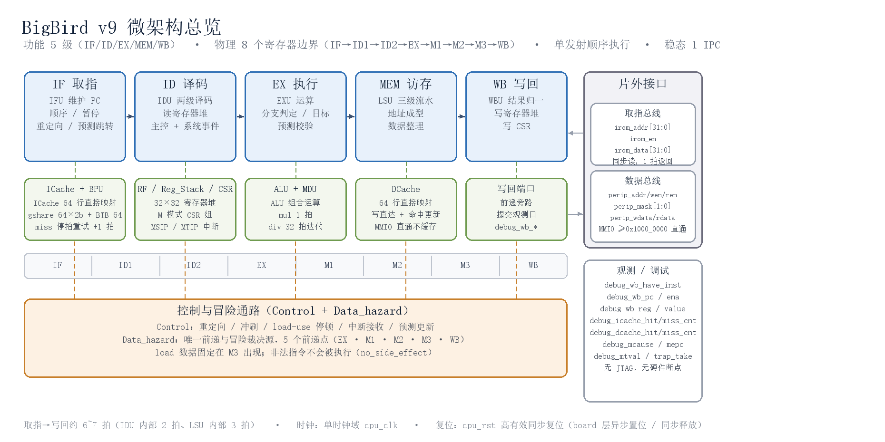
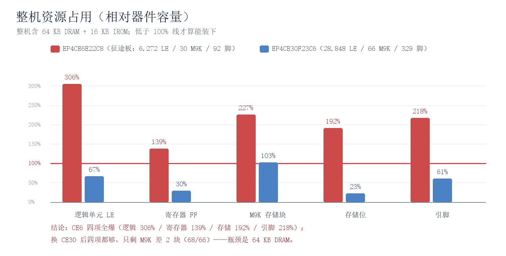

# BigBird v9 32 位 RISC-V 处理器核 · 产品说明

> 文档类型：客户产品说明（Product Brief）｜ 版本：v9（上板改造版 + C 系列修复）
> 适用读者：FPGA / SoC 系统设计者、嵌入式软件工程师、教学与科研平台的选型与采购人员

**一句话定位**：一颗**可上板、可复现、可教学**的 RV32IM 软核 —— 单发射顺序执行、稳态 1 IPC、自带 I/D-Cache 与 gshare 分支预测、机器模式中断与 CSR，交付时附带完整回归套件和 Quartus / ModelSim 实测数据。

## 0. 选型速览（TL;DR）

| 你可能关心的问题 | v9 的答案 |
| --- | --- |
| 指令集 | **RV32IM**：RV32I 整数基址 + M 扩展 8 条乘除；未实现 `ebreak`，不支持 A / F / D / C 扩展 |
| 微架构 | 单发射、顺序执行、功能 5 级 / 物理 8 级流水，**稳态 1 IPC**，周期可静态推算 |
| 能不能上板 | ✅ 已跑通 Quartus II 13.0 综合 + Fitter + TimeQuest；**厂商无关 RTL**，无厂商 IP 依赖 |
| 能跑多快 | ⚠️ 实测 **Fmax 78.2 MHz**（Cyclone IV E，85 °C 慢速模型）；建议**先按 50 MHz 上板** |
| 装得进小器件吗 | ❌ 默认配置装不进 EP4CE6/CE10；需用"精简 Profile"或换 EP4CE22 / EP4CE30 及以上 |
| 能跑操作系统吗 | ❌ 仅机器模式，无 MMU / PMP / U 模式；定位是裸机与轻量 RTOS |
| 浮点 / 原子 / 压缩指令 | ❌ 不支持 F / D / A / C 扩展 |
| 在线调试 | ⚠️ 无 JTAG 调试模块、无硬件断点；提供提交级观测口与异常现场观测口 |
| 异常处理 | ⚠️ `ecall` 通道完全可用；**非法指令与非对齐访存的"陷入"默认关闭**（见第 6 章 D1） |
| 交付完整性 | ✅ RTL + 上板参考设计 + 三条回归线 + 约束/综合脚本 + 逐模块文档 + 实测报告 |

## 1. 产品定位

### 1.1 它是什么

BigBird v9 是一颗面向 **FPGA 实现**的 32 位 RISC-V 软核，设计目标不是"最高性能"，而是**结构清晰、行为可解释、数据可复现**：任何一个性能与资源数字都能在本机用免费工具（Quartus II / ModelSim / iverilog）重跑出来，任何一次 RTL 改动都有回归判据守着。它适合三类客户：

| 客户类型 | 用它来做什么 |
| --- | --- |
| 教学与实验平台 | 计算机组成原理、流水线/冒险/Cache/分支预测的**可视化教具**：波形里能看到前递选择、停顿、重定向、Cache 命中 |
| 科研与验证平台 | 作为 **DUT 基座**：周期确定、结构规整、无乱序，便于加速器挂载、功耗建模、故障注入、形式化验证 |
| 嵌入式原型 | 裸机控制、传感器聚合、协议处理等对频率要求不高（≤50 MHz）但要求**行为可预测**的场景 |

### 1.2 它不是什么（能力边界，先说清楚）

- **不是通用 MCU 产品**：没有 U 模式、没有 MMU/PMP、没有硬件乘除之外的 DSP 加速，不面向量产 SoC 直接流片；
- **不支持操作系统**：无特权级切换与地址翻译，Linux 一类通用 OS 无法运行；
- **无调试子系统**：没有 JTAG DTM、没有断点/单步；观测依赖提交级 debug 端口与波形；
- **单时钟域、单发射**：不支持多核一致性，也没有乱序/超标量；
- **教学 SoC 的地址空间是"两套独立译码"**：取指走 IROM 空间、数据走 DRAM 空间，同一数值区间被两侧分别解释（见 §3.4）。

### 1.3 交付物清单

| 交付项 | 内容 |
| --- | --- |
| 可综合 RTL | 19 个 CPU 模块 + 3 个上板模块，约 **3,458 行 SystemVerilog**（含中文注释） |
| 上板参考设计 | `board/`：同步 BRAM 模型、复位同步释放、`board_top` 顶层、板级冒烟测试台 |
| 回归套件 | `sim/`：7 个测试程序 × {正常, 严格} 模式 + D-Cache 单元测试，自重检查（self-checking） |
| 约束与综合脚本 | `syn/`：SDC/XDC 时序约束、时钟周期扫描、Yosys 资源脚本 |
| 实测报告 | Quartus 资源/Fmax 实测、ModelSim 回归结果、逐模块 I/O 与机制文档 |
| 波形与配图 | 典型指令走查波形（VCD）、微架构总览图、容量画像图 |

## 2. 微架构总览



### 2.1 流水线：功能 5 级、物理 8 级

对外按经典五级描述，对内实际有 **8 个寄存器边界**：

```
物理级:   IF    ID1   ID2   EX    M1    M2    M3    WB
模块:     IFU   IDU   IDU   EXU   LSU   LSU   LSU   WBU
配套:   ICache  RF    -     ALU   DCache -     -     写回口
         BPU   CSR         MDU
```

| 物理级 | 模块 | 职责 |
| --- | --- | --- |
| IF | IFU + ICache + BPU | 维护 PC、取指、预测跳转、暂停/重定向 |
| ID1 | IDU | 接住原始指令（第 1 拍，为同步存储时序留余量） |
| ID2 | IDU + Control + Data_hazard | 组合译码、读寄存器堆、前递选择、冒险判定 |
| EX | EXU + ALU / MDU | 运算、分支判定、跳转目标、预测校验 |
| M1 | LSU | 地址成型、访存控制 |
| M2 | LSU + DCache | 真正发总线、取回数据 |
| M3 | LSU | 访存结果整理（**load 的数据在这一拍才出现**） |
| WB | WBU + RF / CSR | 结果归一化并写回 |

**为什么多出三拍**：`IDU` 拆 2 拍是为了让译码与寄存器堆读在同步存储器时序下仍有完整一拍；`LSU` 拆 3 拍是为了适配**固定 1 拍读延迟的同步 BRAM**（地址拍 → 发总线拍 → 数据整理拍）。代价是单条指令取指到写回约 **6~7 拍**，收益是整条通路只依赖"同步存储器"这一种最容易被综合器推断成 BRAM 的时序模型 —— 这是本核可上板的关键设计决策。

稳态下 **1 IPC**（每拍提交一条指令）；遇到 load-use 冒险、Cache 缺失、除法会插入若干停顿拍。

### 2.2 前递与冒险：单一裁决源

| 项 | 设计 |
| --- | --- |
| 前递点 | **5 个**：EX、M1、M2、M3、WB |
| 裁决位置 | `Data_hazard` 是**唯一**的"数据可不可用 / 要不要停"判定源，其余模块只消费它的输出 |
| load 数据 | 只在 **M3** 出现，因此 load-use 必须停顿到 M3；`M2` 对 load 不是有效前递源 |
| 前接口径 | 每级都必须用同一口径（`R_Wen` + `valid` + 是否 load + `rd != x0`），避免"判定说可用、前递却挡掉"的错配 |
| 同拍一致 | 驱动"谁来前递"与驱动"要不要停"的是**同一组命中条件**，从结构上排除两处口径不同步 |

### 2.3 握手约定（接手这颗核必须知道的 4 条）

1. **`valid`/`ready` 是"寄存输出 + 组合就绪"握手**：本级寄存器只在 `上游 valid & 本级 ready` 时更新，`ready` 由下游逐级回传。
2. **`*_next` 是本级寄存后的输出，`*_last` 是从上一级收到的输入**（例如 `EXU.rd_next` vs `EXU.rd`）。
3. **`stall` 只冻结寄存器，不产生气泡**：`valid_last=0` 表示"保持"，不是"收一个气泡"。因此**不能**用拉低 `valid` 的办法挡指令（会把上游永久堵死，实测死锁）；要作废一条指令，用 `EXU_inst_clear` 把它在 EX 级的控制寄存器清成 NOP。
4. **`hold` 来自同步存储器**：`ICache.hold` / `DCache.hold` 在顶层合并为"冻 PC + 冻 IDU"的 `IFU_stall`，以及参与 `IFU.valid` / `EXU_inst_clear` 的 `IFU_mem_stall`。

这 4 条已写入交付文档，是二次开发时最容易踩坑的地方。

### 2.4 存储层次

| 层次 | 组织 | 策略 |
| --- | --- | --- |
| I-Cache | 直接映射，64 行 × 1 字（32b 数据 + tag + valid） | 命中 1 拍返回；缺失则**停一拍重试**（`hold`），回填后重放 |
| D-Cache | 直接映射，64 行 × 1 字 | **写直达 + 命中更新行**；store 不依赖读数据，通常不停拍 |
| 一致性 | 写直达保证存储器始终是最新值；store 命中时同步合并进缓存行 | 已修掉"load 缺失回填旧值 → store 缺失写直达 → load 命中读到旧值"的错误序列 |
| MMIO 保护 | 地址 `≥ 0x1000_0000` 视为不可缓存 | 恒判定为"不驻留"，读直通外设、不写缓存行，避免把"读清标志/FIFO 出队"这类有副作用的外设寄存器缓存起来 |
| 存储接口 | 同步 SRAM 模型：读 1 拍返回；写为同步写并支持**按访问宽度**的字节写 | 便于直接映射到厂商 BRAM IP |

### 2.5 分支预测

| 项 | 设计 |
| --- | --- |
| 方向预测 | **gshare**：6 位全局历史 GHR 与 PC 低位异或，索引 **64 项 × 2 位**计数器 |
| 目标预测 | **64 项 BTB** |
| 使用位置 | 仅 IF 级用于投机取指；EX 级用真实结果校验并更新 |
| 误预测恢复 | 冲刷前端重取；采用"**挂起-补发**"（settle-then-replay）结构，保证一次判错只产生**一个**重定向脉冲 |
| 可观测性 | `pred_cnt` / `hit_cnt` / `miss_cnt` 计数器可在波形与板上观察 |

### 2.6 执行单元与乘除

| 单元 | 实现 | 延迟 |
| --- | --- | --- |
| ALU | 组合运算器 + 分支比较（5 位统一运算编码，最高位区分是否走 MDU） | 1 拍 |
| MDU | **时序化**：乘法 1 拍；除法 32 拍迭代（`busy` 期间冻结流水） | mul 1 拍 / div 32 拍 |

把 MDU 从"单拍纯组合"改成"乘法单拍 + 除法迭代"是**性价比最高的一处改造**：逻辑规模约降到 **1/5**（2,150 → 407 LC），最长进位链约降到 **1/5**（419 → 81 进位单元），代价是新增 235 个触发器，DSP 用量不变。

### 2.7 机器模式 CSR、中断与异常

| 类别 | 内容 |
| --- | --- |
| CSR | `mstatus` `misa` `mie` `mtvec` `mscratch` `mepc` `mcause` `mtval` `mip` `mvendorid` `marchid` |
| 自定义定时器 | `mtime` (0x7C0) / `mtimecmp` (0x7C1)：**带分频的计数器**，默认分频 100 → 100 MHz 时钟下 **1 MHz 时基**（每 1 µs 加 1），可配置 |
| 中断源 | **MSIP**（软件写 `mip`）、**MTIP**（内部定时器 `mtime ≥ mtimecmp`）；MEIP 已定义编码但**未引出**（见 §6 D7） |
| 中断优先级 | MEI > MSI > MTI |
| 异常 | `ecall`（M 模式）完全可用；非法指令、load/store 非对齐、指令地址非对齐的**判定与 CSR 登记链路已验证正确**，但整块默认关闭（见 §6 D1） |
| 陷入语义 | 精确陷入 `mtvec`；`mstatus.MPIE ← MIE`、`MIE ← 0`；`mret` 返回 `mepc` |
| 非法指令安全修正 | IDU 做完整 RV32I / RV32M 合法性译码，非法指令一律按"无副作用"处理：**不会被真的执行、不会写坏 `rd`** |

## 3. 接口规格：怎么把它接进你的系统

### 3.1 顶层端口（`myCPU`）

| 方向 | 信号 | 位宽 | 说明 |
| --- | --- | --- | --- |
| in | `cpu_clk` | 1 | 唯一时钟（单时钟域） |
| in | `cpu_rst` | 1 | **高有效同步复位**（上板由 `board/reset_sync` 做异步置位、同步释放） |
| out | `irom_addr` | 32 | 取指地址（由 I-Cache 转发） |
| out | `irom_en` | 1 | 取指读使能（同步读请求） |
| in | `irom_data` | 32 | 取指数据（**请求后 1 拍有效**） |
| out | `perip_addr` | 32 | 数据地址（由 D-Cache 转发） |
| out | `perip_wen` | 1 | 写使能 |
| out | `perip_ren` | 1 | 读使能 |
| out | `perip_mask` | 2 | **访问宽度码**：`00`=1 字节 / `01`=2 字节 / `10`=4 字节（字节通道由地址低位决定） |
| out | `perip_wdata` | 32 | 写数据 |
| in | `perip_rdata` | 32 | 读数据（**请求后 1 拍有效**） |
| out | `debug_wb_have_inst` | 1 | 本拍有一次提交 |
| out | `debug_wb_pc` | 32 | 提交指令的 PC |
| out | `debug_wb_ena` | 1 | 提交指令是否写寄存器堆 |
| out | `debug_wb_reg` | 5 | 提交指令的目标寄存器号 |
| out | `debug_wb_value` | 32 | 提交指令的写回值 |
| out | `debug_icache_hit_cnt` / `miss_cnt` | 32 / 32 | I-Cache 命中 / 缺失累计 |
| out | `debug_dcache_hit_cnt` / `miss_cnt` | 32 / 32 | D-Cache 命中 / 缺失累计 |
| out | `debug_mcause` / `mepc` / `mtval` | 32 ×3 | 异常现场：原因 / 出错 PC / 附加信息 |
| out | `debug_trap_take` | 1 | 陷入发生脉冲 |

### 3.2 取指总线时序（同步读，固定 1 拍延迟）

```
周期       T            T+1          T+2
irom_addr  A            A'           A''
irom_en    1            1            1
irom_data  (A-1 的数据)  mem[A]       mem[A']      ← 请求后一拍返回
```

`irom_en` 由 I-Cache 产生：命中时不发总线，缺失时发一次读请求并停一拍重试。

### 3.3 数据总线时序

```
读： T：perip_addr=A, perip_ren=1        T+1：perip_rdata = mem[A]
写： T：perip_addr=A, perip_wen=1,
        perip_wdata=D, perip_mask=W       T+1：mem[A] 中按 mask 选中的字节被更新
```

- `perip_mask` 是**宽度码**而非字节通道掩码：`sb`→`00`、`sh`→`01`、`sw`→`10`；字节通道由地址低位决定，地址在 LSU 内做字对齐；
- 读、写都是**同步**语义（给出请求的下一个时钟沿生效/返回），可直接对接厂商同步 BRAM。

### 3.4 参考设计的地址空间（`board/board_top.sv`）

| 空间 | 范围 | 容量 | 索引方式 | 属性 |
| --- | --- | --- | --- | --- |
| IROM（取指侧） | 0x0000_0000 ~ 0x0000_3FFF | 4096 字 = **16 KB** | `irom_addr[13:2]` | 只读，`$readmemh` 固化程序镜像 |
| DRAM（数据侧） | 0x0000_0000 ~ 0x0000_FFFF | 16384 字 = **64 KB** | `perip_addr[15:2]` | 读写，支持按宽度字节写 |
| MMIO（外设侧） | ≥ 0x1000_0000 | 未占用 | `perip_addr` | D-Cache 恒不缓存，直通外设 |

> **注意（选型必读）**：取指与数据是**两套各自独立译码的地址空间**，同一个数值区间在两侧指不同的存储器 —— 这是教学 SoC 的简化，**不能**把 DRAM 当指令存储器执行。参考设计把整段 `perip` 总线直接接到 DRAM；客户增加 UART / SPI / 定时器等外设时，需要自行在 `perip` 总线上加地址译码，并把外设放在 `≥ 0x1000_0000`（不可缓存区）以避免被缓存。

### 3.5 中断接口

| 中断 | 接入方式 |
| --- | --- |
| MSIP（软件中断） | 由软件写 `mip.MSIP` 触发（也可由外部逻辑实现同样的 CSR 写路径） |
| MTIP（定时器中断） | 核内 `mtime` / `mtimecmp` 比较产生，软件只需设 `mtimecmp` |
| MEIP（外部中断） | **编码已定义、端口未引出**：`meip` 在 RTL 内固定为 0（见 §6 D7，路线图 P1-3） |

### 3.6 上板顶层接口（`board_top`）

| 方向 | 信号 | 说明 |
| --- | --- | --- |
| in | `sys_clk` | 系统时钟 |
| in | `btn_rst_n` | 按键复位（低有效，建议外部消抖） |
| out | `debug_wb_*`、`debug_*_hit/miss_cnt` | 观测口，可接数码管 / LED / UART |
| parameter | `IROM_WORDS` / `DRAM_WORDS` / `IROM_INIT` | 存储器规模与程序镜像，便于做"精简 Profile" |

## 4. 性能画像：能跑多快

### 4.1 周期成本明细（可静态推算）

| 事件 | 额外周期 |
| --- | --- |
| 稳态执行 | **0**（1 IPC） |
| I-Cache 缺失 | **+1 拍**（停一拍重试，回填后重放） |
| D-Cache 缺失（load） | **+1 拍**（hold 后回填重放） |
| store | 通常 **0**（写直达，不依赖读数据） |
| load-use 冒险 | 停顿至 load 数据在 M3 出现（波形中可见 5 拍停顿） |
| 除法 | 32 拍迭代，`busy` 期间冻结流水；乘法 1 拍、无停顿 |
| 分支误预测 | 冲刷前端并重取（前端重填拍数，未单独量化，见 §7 P2-2） |

### 4.2 实测取指效率

在综合演示程序 `prog`（82 拍）上实测：

| 指标 | 实测值 | 含义 |
| --- | --- | --- |
| I-Cache 命中 | 48 | — |
| I-Cache 缺失 | 16 | 每次固定 **+1 拍** |
| 缺失造成的周期占比 | 约 **20%** | 即"停拍重试"式取指策略在本程序上的直接代价 |

这一数字是路线图 P0-2（缓存改标准 valid/ready 握手）的收益依据：把停拍重试改成流水化取指，理论上可把这约 20% 的周期找回来。

### 4.3 时序（Quartus II 13.0 TimeQuest 实测）

| 项 | 实测值 | 条件 |
| --- | --- | --- |
| Fmax | **78.2 MHz** | Cyclone IV E，Slow 1200 mV 85 °C 模型 |
| 100 MHz 下 setup slack | **−2.787 ns** | 约束 10 ns（`syn/v9.sdc`），**不收敛** |
| 100 MHz 下 hold slack | +0.283 ns | 保持余量够 |
| 关键路径数据延迟 | 12.717 ns | `EXU.alu_opcode_reg` → ALU（分支比较）→ `Control`（branch_taken / 误预测判定 / `EXU_inst_clear` / `dnpc_flag`）→ EXU 控制寄存器 |

**关键路径解读**：瓶颈**不在** MDU（已被流水化压下去），而在 **EXU ↔ Control 之间那一大坨组合控制逻辑** —— 分支判定、预测校验、挂起标志与冲刷生成被塞进了同一个时钟周期。

**频率建议**：

| 目标频率 | 余量 | 建议 |
| --- | --- | --- |
| **50 MHz** | +6.5 ns | **上板首选**，几乎确定可跑 |
| 78 MHz | 0 | 当前 RTL 的实测上限（85 °C 慢速模型） |
| 100 MHz | −2.787 ns | 当前 RTL 达不到，需要改结构（见 §7 P1-1） |

### 4.4 时间基准精度

`mtime` 已从"每拍 +1"（100 MHz 下比真实时间快约 1000 万倍，**不可用于计时**）改为**带分频的计数器**：默认分频 100 → **1 MHz 时基，每 1 µs 加 1**，软件可直接按微秒计算延时与定时器中断间隔。

## 5. 资源占用与器件选型



### 5.1 实测资源（Quartus II 13.0.1，Cyclone IV E）

| 配置 | 逻辑单元 LE | 触发器 | 存储位 | M9K | 引脚 | 备注 |
| --- | --- | --- | --- | --- | --- | --- |
| **CPU 核心**（不含存储器） | 18,815 | 8,995 | 6,400 | — | — | 含 24 个 9 位乘法器单元 |
| **整机**（含 16 KB IROM + 64 KB DRAM） | 19,175 | 9,268 | 530,688 | **68** | **201** | 默认配置 |
| **精简变体**（DRAM 16 KB / IROM 8 KB、窄观测口） | 16,935 | 9,201 | 137,472 | **20** | **75** | 在 EP4CE30F23C6 上 **fit 成功** |

### 5.2 换工艺参考（Yosys，Xilinx 7 系列 `xc7`）

| LUT | MUXF7/8 | 触发器 | CARRY4 | DSP48E1 | RAM 原语 |
| --- | --- | --- | --- | --- | --- |
| 8,218 | 1,463 | 5,589 | 521 | 12 | 128 |

### 5.3 能不能装进你的板子

| 器件 | 逻辑 | 寄存器 | M9K | 存储位 | 引脚 | 结论 |
| --- | --- | --- | --- | --- | --- | --- |
| EP4CE6E22C8（征途板，6,272 LE / 30 M9K / 92 脚） | 306% | 139% | 227% | 192% | 218% | ❌ **四项全爆，装不下** |
| EP4CE30F23C6（28,848 LE / 66 M9K / 329 脚） | 67% | 30% | **103%** | 23% | 61% | ⚠️ 只差 **2 块 M9K** |

**结论**：CE30 上唯一超标的是 M9K（68/66），而 **64 KB DRAM 独占整机存储的 99%** —— 瓶颈是存储器规模，不是流水线结构。因此选型路径非常明确：

| 你的板子 | 建议 |
| --- | --- |
| EP4CE6 / CE10 这一档 | 必须用**精简 Profile**：DRAM 缩到 4~16 KB、IROM 缩到 4~8 KB、Cache 64→16 行、BPU 表 64→16 项；预计 M9K 从 68 降到 ~10 |
| EP4CE22 / CE30 及以上 | 可跑**默认配置**（仅需把 DRAM 降到 16 KB，或换 66 块 M9K 以上的封装/器件） |
| 更大器件 / 外挂存储 | IROM/DRAM 走 SDRAM 或 SPI-Flash，FPGA 内只留 Cache 与寄存器堆，可保住全部功能 |

**引脚账**：整机 201 个引脚里有 **128 个**来自 4 个 32 位观测计数器直出顶层。从综合正确性看"引到端口"是必须的（层次化引用会让 Quartus 直接失败），但从上板经济性看是浪费 —— 换成"8 位观察总线 + 3 位选择"或"每位计数器只留 1 位发生过标志"即可（见 §7 P1-2）。

## 6. 已知缺陷与限制（如实披露）

> 编号沿用内部缺陷库。**默认配置（`TRAP_ENABLE = 0`）下 14/14 回归全过**；下表逐项给出影响、现状与建议。

| 编号 | 缺陷 | 影响 | 现状 / 规避 | 建议 |
| --- | --- | --- | --- | --- |
| **D1** | 异常体系（非法指令 / 非对齐访存 / 目标非对齐的**陷入**）默认关闭 | 开启后会影响分支预测恢复（后向分支循环失控）；默认配置下这三类事件**不陷入**，但非法指令仍不会被真的执行 | 判定与 CSR 登记已验证正确（实测 `mcause=2`、`mepc=0x20`）；由 `Control #(.TRAP_ENABLE)` 控制，**默认 0** | 高优先级修完（§7 P0-1）：把异常登记挪到 WB 级、复用已完全调通的 `ecall` 重定向通道 |
| **D2** | 缓存采用"停拍重试"而非标准 valid/ready 握手 | 实测约 **20%** 周期花在取指缺失重试上；接口契约只存在于文档，无断言守护 | 功能正确，代价已量化 | §7 P0-2：改流水化取指，或至少把接口契约写成 SVA 断言 |
| **D3** | `EXU_inst_clear` 是纯组合信号，与 `valid` 的同步语义未系统收紧 | 极端时序下可能出现"该清的没清 / 不该清的清了"；二次开发风险高 | 本轮已修掉"异常标志粘住"一路 | §7 P0-2：补断言 + 明确清除脉冲的相位契约 |
| **D4** | Fmax 78.2 MHz < 100 MHz 目标 | 无法在 100 MHz 约束下收敛（slack −2.787 ns） | 建议先按 50 MHz 上板 | §7 P1-1：把分支判定从 `Control` 挪回 `EXU`、flush 生成再打一拍 |
| **D5** | 默认配置装不进 EP4CE6/CE10 | 小器件客户无法直接使用 | 精简变体已实测 fit 成功 | §7 P2-1：交付官方"精简 Profile"参数集 |
| **D6** | 4 个 32 位观测计数器直出顶层 | 占 **128** 个引脚（整机 201 脚） | 精简变体已改用窄接口（2 脚） | §7 P1-2：统一改成 8 位观察总线 + `sel` |
| **D7** | MEIP（外部中断）编码已定义但端口未引出 | **外部中断不可用**，只能靠 MSIP/MTIP | RTL 内 `meip` 固定为 0 | §7 P1-3：引出端口并补标准 CLINT 内存映射 |
| **D8** | 未实现 `ebreak` | 无断点异常（`mcause=3` 编码已保留） | — | 与 D1 一并处理 |
| **D9** | `fence` / `fence.i` 已识别但按无副作用处理 | 不提供标准 cache 维护语义；在本核"取指与数据各占独立存储空间"的前提下不影响正确性 | 已修掉"fence 被静默丢弃"的老问题 | 若将来支持自修改代码（IROM 可写），必须补 `fence.i` → 清 I-Cache |
| **D10** | 验证覆盖不足 | 缺 47 条全指令表 difftest（本机无 verilator/make）；CSR 全字段、`fence.i` 组合、立即数边界的覆盖偏窄 | 替代回归 103/103 + ModelSim 16/16 | §7 P2-2：在有工具链的机器上补跑 + 收集覆盖率 |
| **D11** | 板级外设译码未提供 | 数码管 / LED / UART 的板卡译码模块需客户自行实现 | 观测口已引出，接法在文档中给出示例 | §7 P2-3：随板卡提供参考译码 |
| **D12** | 存储器是行为模型 | `board/sync_mem.sv` 是行为级 BRAM，上板需替换为厂商 IP（`xpm_memory_*` / Megafunction），并固定"读延迟 1 拍" | 仿真语义与厂商 BRAM 一致 | 交付 IP 替换指引（路线图 P2-3） |
| **D13** | 特权级与保护缺失 | 仅 M 模式，无 U 模式 / MMU / PMP | 定位使然 | 不作为近期目标 |

### 6.1 已修复的历史缺陷（不再影响客户）

为完整起见，客户拿到的版本已经修掉了下列**真实 RTL 缺陷**（均经回归验证）：

| 类别 | 内容 |
| --- | --- |
| 上板阻断 | `board_top` 的 5 处**层次化引用**（Quartus 直接 `Error 10207` 综合失败）；`sync_mem` 初始化循环越过 Quartus 的 5000 次上限（`Error 10106`） |
| 功能正确性 | load-use 前递取到的是**地址**而不是数据；重定向连环触发导致目标指令永远进不了流水；`ecall` 因 `EXU_inst_clear` 把指令自己清掉而**永不产生异常**；写回被 `valid` 掉拍掐掉 |
| 访存 | load 的字节/半字未按地址低位选道（`lb/lh/lbu/lhu` 永远读到第 0 字节）；D-Cache 读握手 off-by-one；写直达缓存与存储器的一致性问题 |
| 多拍握手 | MDU"重复发射"导致用旧操作码算下一条指令；背靠背除法握手未重置 |
| 结构清理 | 前递/冒险判定双口径（收敛为单一裁决源）；5 个死信号；`mtval` 从死寄存器变为真正登记异常现场 |

## 7. 优化路线图

按"客户可感知收益 ÷ 工作量"排序。所有条目都**不需要**推翻现有微架构。

| 优先级 | 项目 | 预期收益 | 工作量 | 风险 |
| --- | --- | --- | --- | --- |
| **P0-1** | **修完异常体系**（登记挪到 WB 级，复用 `ecall` 通道），默认打开 | 交付完整的非法指令 / 非对齐访存陷入能力，向规范靠拢 | 中（改 `Control`/`CSR`/`EXU` 三处 + 专项程序回归） | 中：要重新验证与分支预测恢复的交互 |
| **P0-2** | **缓存改标准 valid/ready 握手** + 为 `EXU_inst_clear`、`hold`、前递口径补 **SVA 断言** | 找回实测约 **20%** 的取指缺失周期；把"口头契约"变成可执行契约 | 大（Cache + IFU + LSU + 顶层同时动） | 高：属结构性改动；建议先做断言、再动握手 |
| **P1-1** | **打断 EXU ↔ Control 关键路径**（分支判定回归 EXU、flush 生成再打一拍） | 目标 **100 MHz**（当前 78.2 MHz，需回收 2.787 ns） | 中 | 中：会改变重定向时序，需重跑全部回归 |
| **P1-2** | 观测口改**窄接口**（8 位总线 + 3 位 `sel`） | 引脚从 201 降到约 80，小器件可装 | 小 | 低 |
| **P1-3** | **引出 MEIP**，`mtime/mtimecmp` 改标准 CLINT 内存映射 | 外部中断可用；定时器接口与生态一致 | 小~中 | 低 |
| **P2-1** | 交付**精简 Profile** 参数集（DRAM 4~16 KB、Cache 16 行、BPU 16 项） | EP4CE6/CE10 这一档可上板 | 小 | 低（仅改参数与回归脚本） |
| **P2-2** | **覆盖率与形式化**：47 条全指令表 difftest + CSR/立即数边界 + SVA 覆盖率 | 把"能跑通"升级为"可证明的覆盖" | 中 | 低 |
| **P2-3** | 外挂存储子系统（SDRAM / SPI-Flash）+ 厂商 BRAM IP 替换指引 | 突破片内 64 KB 限制，保住全部功能 | 大 | 中：需写存储控制器 |
| **P3** | 性能计数器（PMU）、可选 I-Cache 预取、BTB 扩容、双发射探索 | 进一步提升 IPC | 大 | 高：可能超出"教学可解释性"的定位 |

**一句话路线图**：**P0 补完整性与性能，P1 冲频率与引脚，P2 扩生态与验证**。做完 P0+P1（4 项），这颗核就能以"完整异常 + 100 MHz + 小器件可选 + 低引脚"的形态进入下一版。

## 8. 交付、验证与复现

### 8.1 三条回归线（客户可自行复现）

| 回归线 | 工具 | 内容 | 实测结果 |
| --- | --- | --- | --- |
| 功能回归（快） | iverilog 12.0 | 3 个程序 ×{正常, 严格} + D-Cache 单元测试 = 7 项 | **103/103 检查全过** |
| 功能回归（权威） | ModelSim SE-64 10.5 | **7 个程序 ×{正常, 严格} = 14 项** + D-Cache 单元测试 = 15 项；另有上板路径测试台 33 项 | **15/15 ALL PASS**，上板路径 **33/33 PASS** |
| 综合与时序 | Quartus II 13.0.1 | Analysis & Synthesis + Fitter + TimeQuest | 资源见 §5，Fmax 见 §4.3 |

**"严格模式"**的含义：额外加 `+no_wbu_force +raw_rf`，即**不使用测试台任何兜底手段**（不强制写回级暂停、不预清寄存器堆），用于验证 RTL 自身是否干净。两种模式结果一致。

| 程序 | 覆盖面 |
| --- | --- |
| `prog` | 算术 / 乘法 / load-use / 分支 / `jal` / `ecall`（35 项检查） |
| `prog_mul` | 连续 8 条乘法（全程 `stall=0`，1 IPC） |
| `prog_div` | 4 次除法（MDU 多拍冻结流水） |
| `prog_load_lane` | `lb/lh/lbu/lhu` 的字节/半字选道 |
| `prog_load_use` | load 后紧跟消费者的前递 |
| `prog_loop` | 后向分支循环（预测 + 误预测恢复） |
| `prog_div_pair` | 背靠背除法（MDU 握手重置） |
| `tb_dcache_unit` | D-Cache：miss→fill、二次命中、写直达、MMIO 不缓存、外设副作用 |

### 8.2 一条命令复现

```
:: 功能回归（ModelSim）
sim\run_msim.bat

:: 功能回归（iverilog）
bash sim/run_all.sh

:: 综合资源（Quartus）
quartus\build\ 下的 v9_core / v9_board / v9_board_small 三个工程
```

### 8.3 支持范围

| 项目 | 范围 |
| --- | --- |
| 交付形态 | 可综合 SystemVerilog 源码 + 上板参考设计 + 验证套件 + 文档 |
| 已验证工具 | iverilog 12.0、ModelSim SE-64 10.5、Quartus II 13.0.1、（资源参考）Yosys |
| 已验证器件 | Cyclone IV E（EP4CE6 / EP4CE30）、Xilinx 7 系列（资源估算） |
| 未验证 | 真实板级运行、真实 BRAM IP 推断、其他厂商/工艺的综合与时序 |

## 附录 A · 术语与缩略语

| 术语 | 含义 |
| --- | --- |
| RV32IM | RISC-V 32 位整数指令集 + 乘除扩展（M） |
| IPC | 每周期提交指令数 |
| IF/ID/EX/MEM/WB | 经典五级流水：取指/译码/执行/访存/写回 |
| ID1/ID2、M1/M2/M3 | 本核内部拆出的物理流水级 |
| gshare / GHR / PHT / BTB | 全局历史异或索引的分支预测 / 全局历史寄存器 / 模式历史表 / 分支目标缓冲 |
| I-Cache / D-Cache | 指令缓存 / 数据缓存 |
| MMIO | 内存映射 I/O（本核中 ≥ 0x1000_0000 的不可缓存区间） |
| CSR | 控制状态寄存器（机器模式） |
| MSIP / MTIP / MEIP | 机器软件 / 定时器 / 外部中断 |
| MDU | 乘除单元 |
| IPC 代价 / hold | 停顿拍；同步存储器返回的"需停一拍重试"请求 |
| Fmax | 最高工作频率（时序分析给出的上限） |

## 附录 B · 测量条件（数据可复现性声明）

| 项 | 条件 |
| --- | --- |
| 综合/时序工具 | Quartus II 13.0.1 Build 232 SP1（64 位） |
| 时序模型 | Cyclone IV E，Slow 1200 mV 85 °C |
| 时序约束 | `syn/v9.sdc`，主时钟 10 ns（100 MHz） |
| 目标器件 | EP4CE6E22C8（征途板）、EP4CE30F23C6 |
| 仿真工具 | ModelSim SE-64 10.5（2016.02）、iverilog 12.0 |
| 资源参考（换工艺） | Yosys + `synth_xilinx -family xc7` |
| SystemVerilog 支持 | Quartus 工程必须声明 `VERILOG_INPUT_VERSION SYSTEMVERILOG_2005`，否则语法报错满屏 |

> 本章数字均来自上述工具与版本的实测输出，全部可由 `sim/` 与 `quartus/build/` 下的脚本复现。

## 附录 C · 适用性与免责声明

1. 本核定位为**教学、科研与原型验证**用途，**未**经过量产级的验证、老化、ESD 与可靠性考核，不建议直接用于量产产品；
2. 除 §8.3 明确列出的工具与器件外，其他工具链/工艺的综合与时序结果**未经实测**，需客户自行验证；
3. 本文档中的性能与资源数字均依赖附录 B 的测量条件，更换工具版本、器件或温度模型会得到不同结果；
4. 第 6 章列出的缺陷与限制是**当前版本的如实状态**，采购与项目规划时请以该表为准，不要按"理论规格"评估风险；
5. 路线图中的优先级与工作量评估为工程估算，不构成交付承诺。
